# hmc-optimizations benchmarks

`bench.py` measures Minecraft running headless with HeadlessMc, with and without hmc-optimizations. It covers three things:

1. **compare**: performance and memory (FPS, MSPT, heap, metaspace, NMT, RSS, GC) of three scenarios:
   `vanilla` (no mod), `optimized` (mod active) and `optimize-off` (mod installed, but switched off with the `optimize` command after joining).
2. **leak**: memory leak hunt with `jcmd GC.class_histogram` over time, heap dumps analysed by Eclipse MAT (leak suspects) and JFR `OldObjectSample`.
3. **render**: JFR execution and allocation samples of the optimized client, attributed to render path code and ranked.

Only the Python 3 standard library is used. Everything is written to `benchmark/work/<loader>-<mc>/` (git ignored). Dummy assets are used, so no Mojang account or asset download is needed.

## Requirements

- Linux, Python 3.8+.
- A JDK to run Minecraft with (`--java-home`, must contain `jcmd` and `jfr`; Java 21 for 1.21.x, Java 17 for 1.18-1.20.4, ...).
- Java 25+ for HeadlessMc itself (`--hmc-java-home`; defaults to `--java-home`).
- Internet access for `setup` (HeadlessMc, HMC-Specifics, Eclipse MAT, Minecraft).
- About 2.5 GB RAM per run (`--xmx 2G`) and about 3 GB disk per heap dump set. One Minecraft instance runs at a time.

## Setup

```sh
python3 -I benchmark/bench.py setup --mc 1.21.4 --loader fabric --java-home ~/.jdks/temurin-21.0.9 \
    --hmc-java-home ~/.jdks/temurin-25.0.1 --build --mat
python3 -I benchmark/bench.py world --mc 1.21.4 --loader fabric --java-home ~/.jdks/temurin-21.0.9 --hmc-java-home ~/.jdks/temurin-25.0.1
```

`setup` downloads the tools, builds (`--build`) or takes (`--jar`) the release jar from `hmc-optimizations-<mc>`, and installs Minecraft. `--mat` also downloads Eclipse MAT. `world` creates the template world that every run copies and joins.

## Running

All commands take `--mc`, `--loader`, `--java-home`, `--hmc-java-home`, `--xmx` and `--xvfb` (render with Xvfb instead of HeadlessMc headless mode).

```sh
COMMON="--mc 1.21.4 --loader fabric --java-home ~/.jdks/temurin-21.0.9 --hmc-java-home ~/.jdks/temurin-25.0.1"

# performance and memory, vanilla vs optimized vs mod-disabled
python3 -I benchmark/bench.py compare $COMMON --scenarios vanilla,optimized,optimize-off --reps 3 --duration 300

# leaks (histogram every 5 min, heap dumps at start and end, MAT, JFR OldObjectSample)
python3 -I benchmark/bench.py leak $COMMON --duration 3600 --heap-dumps --move-every 30

# render hotspots with the optimizations on
python3 -I benchmark/bench.py render $COMMON --duration 180

# redo reports
python3 -I benchmark/bench.py analyze $COMMON <render.jfr>
python3 -I benchmark/bench.py summarize <compare result dir>
```

Useful options: `--warmup` seconds in the world before measuring, `--interval` sampling period, `--nmt-interval`, `--move-every N` (teleports the player every N seconds so chunks keep loading), `--attempts` (retries a run when the game fails to start), `--scenario` for leak/render.

Results go to `benchmark/work/<loader>-<mc>/results/<mode>-<scenario>-<timestamp>/` with `summary.md` / `leak-report.md` / the render report, `samples.csv`, `gc.log`, JFR files and heap dumps.

`compare` and `summarize` also render SVG charts into `charts/` next to `summary.md` and embed them in it: bar charts of
the mean FPS, heap, RSS, native memory and GC per scenario, and line charts of heap and RSS over the measured time.
`leak` renders the heap and RSS of its run over time into `charts/memory.svg`.

## What the metrics mean

| Metric | Meaning |
|---|---|
| FPS / Client MSPT | Frames per second of the client loop, and average client tick time. Vsync is off and the FPS limit is raised, so scenarios are not capped equally. |
| Heap used / committed | Java heap in use / reserved from the OS, from `jcmd GC.heap_info`. |
| Heap after GC | Live heap occupancy after each GC pause (from the GC log). The best indicator of what is really retained. |
| Metaspace (NMT class) | Class metadata, from Native Memory Tracking (`jcmd VM.native_memory summary`). |
| NMT committed total / heap / threads / code cache / GC / other | Committed native memory per JVM area. "other" includes direct buffers. |
| RSS | Resident set size of the whole process tree (`/proc`), includes things NMT cannot see (native libraries). |
| GC pauses per minute / pause time | From the GC log in the measured window. |

Per metric mean, median and p95 are reported across all samples of all repetitions of a scenario, plus the relative difference to vanilla (negative is better for memory/GC, positive for FPS).

## Reading the leak report

`leak-report.md` has:

- **Memory over time**: heap, RSS, NMT at start and end. A leak is memory that keeps rising *after* the world has settled. A rise during the first minutes is expected (chunk loading, JIT, caches).
- **Live heap after full GC** per histogram. Compare the last values: a plateau means no leak, a steady slope means a leak.
- **Growing classes**: classes that grew in the class histograms. "Monotonic" and a high "Growing steps" percentage are the interesting ones. Growth in chunk, structure or palette classes while the player explores is world data, not a leak. Look for classes unrelated to what the test does, or ones that do not stop growing once the player stops moving.
- **Long lived allocations (JFR OldObjectSample)**: allocation sites of objects still alive at the end, with the GC root that holds them. Open `leak.jfr` in JDK Mission Control for path-to-GC-root.
- **Eclipse MAT**: `end_Leak_Suspects.zip` is the MAT leak suspects report of the end heap dump. Unzip and open `index.html`. A suspect that is only "the server's chunk map holds 30% of the heap" is normal.
Use a longer `--duration` and a stationary player (`--move-every 0`, `leak` teleports every 30 s by default) to separate warm-up growth from leaks.

## Reading the render hotspot report

JFR records `ExecutionSample` (CPU, every `--cpu-period` ms) and `ObjectAllocationSample`. A stack counts as render path when a render class (`net.minecraft.client.renderer`, `gui`, `particle`, `texture`, `blaze3d`, `lwjgl`, HeadlessMc lwjgl redirections, ...) is on it, excluding server, networking and startup threads. Each sample is credited to the render frame closest to the top of the stack. Tables are ranked by own cost and by inclusive cost, with "% of all" (of all samples) and "% of render path". Call trees show where in the render path the samples come from. Only rendering counts; the rest of the process is ignored. Idle/parked threads are not sampled, so shares are shares of Java code that ran.

## Validation results

Minecraft 1.21.4, Fabric, Temurin 21, `-Xmx2G`, headless (`-lwjgl`), 2 repetitions x 120 s after 30 s warmup, sampled every 5 s, NMT every 10 s (`benchmark/bench.py compare`, 2026-10-17). The charts below are copied from that run into [`charts/`](charts).

| Metric (mean) | vanilla | optimized | optimize-off |
|---|---|---|---|
| FPS | 3,782 | 906,003 (render skipped) | 4,237 |
| Client MSPT | 1.3 | 1.4 | 1.3 |
| Heap used (MB) | 599 | 482 (-20%) | 614 |
| Heap committed (MB) | 982 | 691 (-30%) | 980 |
| Heap after GC (MB) | 309 | 312 (+1%) | 300 |
| Process RSS (MB) | 1,447 | 1,113 (-23%) | 1,511 |
| NMT committed total (MB) | 1,316 | 1,014 (-23%) | 1,318 |
| NMT class/metaspace (MB) | 21.7 | 21.5 | 21.6 |
| NMT GC (MB) | 76.6 | 69.8 (-9%) | 76.4 |
| GC pauses per minute | 455 | 146 (-68%) | 353 |
| GC pause time (ms/min) | 447 | 265 (-41%) | 352 |

`optimize-off` behaves like vanilla (memory within noise), so the mod costs nothing when disabled. The live heap (heap after GC) is the same in all scenarios: the optimized client saves memory by allocating less (fewer GCs, less heap committed), not by holding less. The FPS figure of the optimized client is not a real frame rate: the optimizations skip the render work, so the loop is only limited by the (redirected) window calls. Short runs and 2 repetitions: treat differences of a few percent as noise.

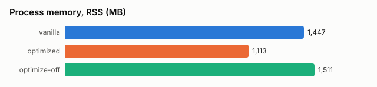

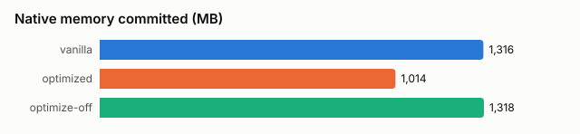

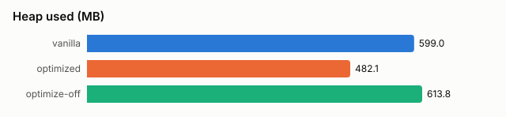

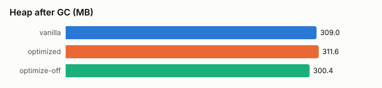

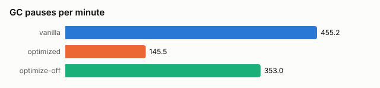

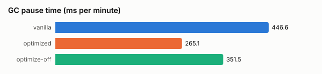

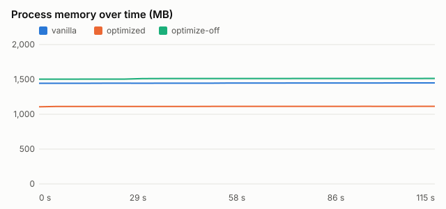

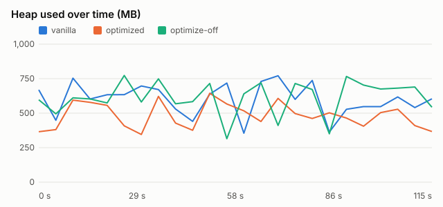

### Leak runs (optimized)

Standing still, 1200 s (`leak --duration 1200 --histogram-interval 120 --move-every 0 --heap-dumps`):

- Live heap after full GC: 284 MB in all 11 histograms. No class grew by 256 KB or more. No leak.
- NMT class/metaspace flat (21.7 -> 21.8 MB), NMT total 917 -> 896 MB, threads 35 -> 24 (idle worldgen workers exit).
- RSS 1,052 -> 1,087 MB, outside the memory NMT tracks (native libraries, malloc). Small, but run longer to see whether it levels off.

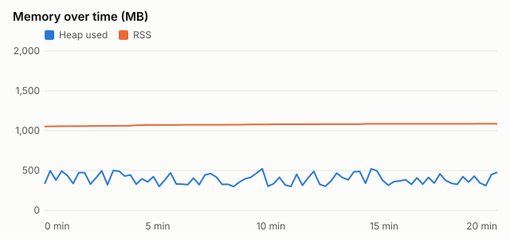

Teleporting 256 blocks every 30 s, 900 s (the `leak` default):

- Live heap after full GC: 284, 420, 425, 437, 449, 448, 458 MB. It rises while new chunks load and flattens.
- Growing classes (`long[]`, `BlockPos`, `StructureTemplate$StructureBlockInfo`, `PalettedContainer`, `DensityFunctions`) are chunk, structure and worldgen data of the integrated server.
- MAT leak suspects: the server `ChunkMap` (29% of the heap, 129 MB) and the loaded classes. Both are normal Minecraft state. No hmc-optimizations class appears in suspects, growing classes or OldObjectSample roots.

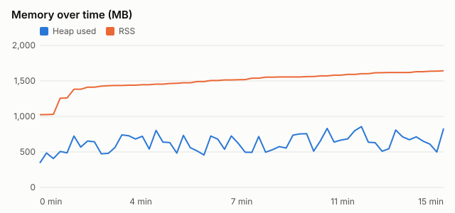

### Where memory could still be saved

Retained heap of the optimized client by area, from the Eclipse MAT dominator tree (grouped by class) of the end heap dump of the stationary leak run (273 MB retained). Each object is counted once, under the object that keeps it alive. Made by hand from `ParseHeapDump.sh end.hprof '-command=dominator_tree -groupBy BY_CLASS' -format=csv -unzip org.eclipse.mat.api:query`, `bench.py` does not produce this chart.

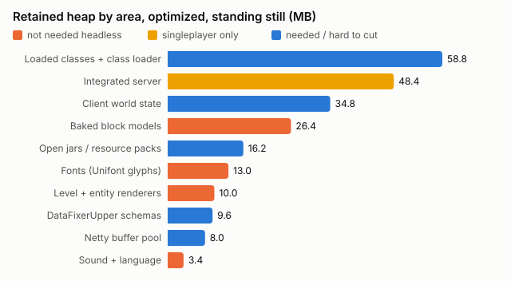

| Area | MB | Contents |
|---|---|---|
| Baked block models | 26.4 | `SimpleBakedModel` 10.4, `MultiPartBakedModel` 9.0, `ModelManager` 7.0 (17,531 models) |
| Fonts | 13.0 | 123,258 `UnihexProvider` (Unifont) glyphs in `FontManager` |
| Level and entity renderers | 10.0 | `LevelRenderer` 6.3, `EntityRenderDispatcher` 3.7 |
| Sound and language | 3.4 | `SoundManager` 2.4, `ClientLanguage` 1.0 |
| Integrated server | 48.4 | `ChunkMap` 27.6, light engine 8.0, structure templates 7.1. Singleplayer only, a client on a server does not have it |
| Client world state | 34.8 | `BlockState` 15.2, `ClientLevel` 12.4, voxel shapes 6.4 |
| Loaded classes | 58.8 | 12,377 classes, `KnotClassLoader` |
| Open jars and resource packs | 16.2 | 85 `ZipFile$Source`, the client jar `ZipFileSystem` |
| DataFixerUpper | 9.6 | type templates and schemas |
| Netty | 8.0 | 2 pooled `PoolChunk`s |

Candidates, largest first:

1. **Heap headroom and GC**: the optimized client commits 556-691 MB of heap for 284 MB of live data, and G1 itself takes 70 MB (NMT GC). `-XX:+UseSerialGC`, or G1 with `-XX:G1PeriodicGCInterval` and a lower `-XX:MaxHeapFreeRatio`, may save a few hundred MB of RSS without any mod code (untested). Part of the churn comes from the HeadlessMc lwjgl redirections boxing a `Double` per `glfwGetTime` call (see the render report).
2. **Baked block models** (about 26 MB, more with real assets): nothing renders them headless. Particles and some mods read models, and `optimize off` at runtime would need a resource reload.
3. **Unifont glyphs** (13 MB): a headless client draws no text. ASCII widths come from the bitmap provider, only non-Latin text widths would change.
4. **Animated textures**: the largest remaining render cost (see below) and native memory for the frames, which dummy assets do not show.
5. **Smaller**: level/entity renderers (10 MB), sound registry and language (3.4 MB). Per thread biome temperature caches (`Biome$1`, `Long2FloatLinkedOpenHashMap`) held 20 MB on worldgen worker threads in the teleporting run, singleplayer only and released when the workers exit.

Dummy assets make models, fonts and textures smaller than with the real resource pack, so the headless-only areas are likely larger in practice.

### Render hotspots with the optimizations on (150 s JFR)

Of 11,909 CPU samples, 475 (4.0%) have a render frame; the render thread itself is only 8.5% of all samples (46.9% of it render path). Top render hotspots by own CPU cost (% of render path samples):

| # | Method | Category | % of render path |
|---|---|---|---|
| 1 | `MemoryUtil.memGetInt` (via `NativeImage.getPixel`, animated sprite interpolation) | lwjgl | 21.9% |
| 2 | `HeadlessMc DefaultRedirections.fallback` (glfwGetTime and others, `HashMap.getNode`) | hmc lwjgl redirection | 13.1% |
| 3 | `GLFW.glfwWindowShouldClose` | lwjgl | 11.4% |
| 4 | `GL11.glTexSubImage2D` (`SpriteContents.upload`) | lwjgl | 10.9% |
| 5 | `LwjglRedirections.lambda$register$2` (`Double.valueOf`, glfwGetTime) | hmc lwjgl redirection | 6.9% |

By inclusive cost, `TextureManager.tick` -> `TextureAtlas.cycleAnimationFrames` -> `SpriteContents$Ticker.tickAndUpload` -> `InterpolationData.uploadInterpolatedFrame` takes 49.3% of the render path (about 2% of all samples), so animated block textures are the main remaining render work. Next are the HeadlessMc lwjgl redirections (26.7%, `RedirectionManagerImpl.invoke`, `glfwGetTime` 19.6%). The same redirections also dominate allocation: `MemoryUtil.memPutInt` (31.5%), `LwjglRedirections.lambda$register$2` (23.5%, boxed doubles), `RedirectionManagerImpl.invoke` (14.6%), `glfwGetTime` (13.7%) of 103 GB allocated by the render path in 150 s.

## Limitations

- Validated on Fabric 1.21.4 only; other versions and loaders are untested (the script is version-generic: Mojang name remapping is done from the Fabric intermediary mappings).
- Dummy assets and a stubbed GL mean FPS numbers compare "work skipped" with "work stubbed"; they are not a GPU benchmark. Use `--xvfb` for software rendering.
- Few repetitions and short durations in the committed validation numbers; use `--reps 3+` and longer durations for publication.
- JFR sampling is statistical: small percentages (below about 1% of the render path) are noisy.
